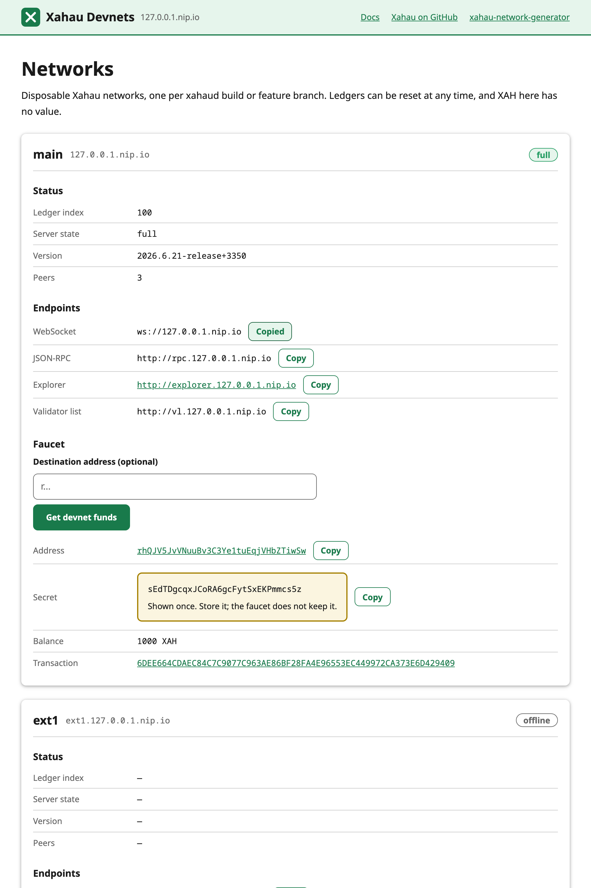

# xahau-network-generator

CLI that generates and runs disposable Xahau `testnet` (N validators) or
`standalone` networks for a given `xahaud` release, via Docker Compose.

## Usage

```sh
pnpm install
pnpm xng doctor   # docker, compose, build.xahau.tech reachable? optional features (proxy, TLS, Cloudflare) on/off

# create a network (downloads/caches the xahaud binary, derives amendments,
# generates keys/genesis/config into workspace/<name>/)
pnpm xng create --name t1 --type testnet --validators 3
pnpm xng create --name s1 --type standalone
# register a testnet that runs on another host (network.json only, nothing started)
pnpm xng create --name foo --external --domain xahau-dev.net --tls

# start it (docker compose up -d), optionally waiting for readiness
pnpm xng start --name t1 --wait

# stop / reset (wipe ledger data, restart from genesis) / remove
pnpm xng stop --name t1
pnpm xng reset --name t1 --wait
pnpm xng remove --name t1

# rolling upgrade of a running testnet, no downtime: new binary and/or new xahaud.cfg
pnpm xng upgrade --name t1 --version 2026.9.9-dev+3667
pnpm xng upgrade --name t1 --node-config '{"ledger_history":["5000"]}'

# make every validator vote for (or, with --reject, veto) an amendment
pnpm xng vote --name t1 --amendment fixSomething

# rotate the UNL of a running testnet: add validators, publish the new list,
# then stop and delete the ones that left it (default: replace every validator)
pnpm xng rotate --name t1                    # v1,v2,v3 -> v4,v5,v6
pnpm xng rotate --name t1 --add 1 --remove v2

# declare all networks in xng.yml and let xng work out the difference
pnpm xng apply --dry-run
pnpm xng apply
```

`reset` = stop, wipe ledger data, start again from genesis.

Every generated container is `restart: unless-stopped`, so after a host
reboot the network (and the shared Traefik) comes back on its own and each
node resumes from its last validated ledger (`--load`; standalone
`-a --load`), never from genesis — `xng reset` is the only thing that goes
back to genesis. `xng start`/`xng reset` re-render compose.yml, so networks
created before this existed pick it up on their next start. Keys are
generated at create time only; xahaud.cfg is re-rendered by `xng upgrade`
(even with no flags), which overwrites hand edits.

`upgrade` (testnet only) replaces the xahaud binary and re-renders each node's
`xahaud.cfg` (`--node-config`/`--validator-config` replace those settings, `{}`
removes them; `--version` defaults to the current one, so a config-only change
keeps the binary) one node at a time —
`node` first, then `relay` if any, then each validator in order — waiting for each to rejoin
consensus on the new version before moving to the next, so the network is
never fully stopped. The default quorum is capped at `validators - 1` (see
below), so one validator can be mid-restart and consensus still keeps going;
pass `--quorum` yourself to raise it if you want stricter safety instead.
With the current binary and an unchanged `validatorConfig` and `importVlKeys` (e.g. `--node-config`
only) just `node` is restarted; `--relay-config` restarts only `relay` (and `node`).

`rotate` (testnet only) replaces validators of a running network without
stopping consensus. It starts the `--add` new validators (default: as many as
there are), publishes an interim validator list (VL) holding old and new, and
waits until every node trusts exactly that set and the new validators report
`proposing`. It then publishes the final list (kept plus new), waits until every
remaining node trusts exactly it, and stops the validators in `--remove`
(default: all the old ones), removes their containers and deletes their
`nodes/`, `bin/` and `keys/` entries. `--remove` alone shrinks, `--add` alone
grows; the result must still be >= 3 validators. `vl.json` sets
`refresh_interval` 1, so each node re-fetches the list within a minute; a
network created before that existed still runs on the 5-minute default, so
its first rotation can spend ~5 minutes per phase waiting (pass a larger
`--timeout`), later ones a minute.
`validatorIds` in network.json records which `v<n>` exist (absent = 1..N); new
validators continue after the highest number ever used. The other nodes'
`[ips_fixed]` on disk are rewritten, but a running process applies them only on
its next restart (`xng upgrade`). When the count changes, `quorum` is reset to
its default and `node` (plus `relay`, if any) and the kept validators are recreated one at a time
(like `xng upgrade`) during the interim phase, before the final list is
published, so the new quorum is always satisfiable. `xng apply` plans a rotation
when only `validators` changes in the yml (`--add` for more, `--remove` of the
highest-numbered ones for fewer); its `--timeout` bounds the rotation, so raise
it when the count changes (a quorum roll adds about a minute per node). A yml
`quorum` that is not the default for the new count still recreates. The yml can
pin the set with `validatorIds` (`xng create --validator-ids 1,2,5`, `xng rotate
--add-ids 4,5`); a set that differs from the one on disk, even with the same
count, is a rotation that adds the missing ids and removes the extra ones.

`vote` (testnet only) runs `feature <amendment> accept|reject` on each
validator. Every generated node sets `[amendment_majority_time]` to
1 minute (xahaud's floor), so an amendment with a majority is enabled at the
next flag ledger (every 256 ledgers) at least a minute later.

`--version` defaults to the latest release on build.xahau.tech. Binaries and
parsed amendment sources are cached under `~/.cache/xahau-network-generator`.
The testnet faucet's own key is generated per-network at `workspace/<name>/keys/faucet.json`.

### Networking

**testnet** networks publish nothing on a host port (not even the peer port —
xahaud's peer TLS sends no SNI, so it can't be proxied). Instead, `xng start`
and `xng reset` bring up a single shared Traefik instance (`xng proxy up` /
`xng proxy down` to manage it directly) that every testnet joins via the
external `proxy` Docker network, and routes each service by subdomain, e.g.
for a network named `t1`:

```
http://explorer.t1.127.0.0.1.nip.io
http://rpc.t1.127.0.0.1.nip.io
ws://t1.127.0.0.1.nip.io
http://faucet.t1.127.0.0.1.nip.io
ws://t1.127.0.0.1.nip.io/debugstream/<r-address>
```

The default domain, `127.0.0.1.nip.io`, resolves any subdomain to
`127.0.0.1` so this works out of the box on plain HTTP.

**Hook debug stream.** Every testnet's `node` logs hook `trace()` output,
SetHook validation, RPC replies and consensus metadata (xahaud's `View`,
`OpenLedger`, `LedgerConsensus`, `RPC`, `Server` and `NetworkOPs` partitions
at trace) to `workspace/<name>/nodes/node/log/debug.log`. The `debugstream`
service tails that file and streams it over WebSocket at
`ws(s)://<base>/debugstream/<r-address>` (every log entry mentioning that
account, what `wss://xahau-test.net/debugstream/<r-address>` sends) or
`/debugstream/` (the `Hook*` entries for every account). Messages are the raw
log entries, and anything a client sends is answered with the account, as on xahau-test.net.
Opening the same path in a browser (`http(s)://<base>/debugstream/<r-address>`)
shows a live viewer page, as on xahau-test.net. The file is only the hand-off between xahaud and the service: it keeps
no history and is truncated once it passes 10 MiB, so it never accumulates.
Every xahaud container's docker log is capped at 20 MB × 3 as well, since
xahaud writes the same lines to stderr. Standalone networks have no stream
service and write no log file; `node` still traces hooks to stderr, so
`docker logs -f <name>-node 2>&1 | grep HookTrace` does the same job there.
xahaud.cfg is written at create time, so a testnet created by an older xng
gets the stream service on its next start but no log to tail until it is
recreated.

### featureExport (relayer)

A xahaud build with featureExport needs a non-validating xahaud that peers
with the other network (the "relayer"). Put its `[xrpl_relay]` section in
`relayConfig` (testnet only; `xng create`/`upgrade --relay-config <json>`) and
xng runs it as a separate `relay` service (container `<name>-relay`) beside
`node`, peered to every validator:

```yaml
relayConfig:
  xrpl_relay: ["xrpl-hub.example.com 51235", "network_id=1"]
```

The peer should be an XRPL node you run (or have an arrangement with), not a
public server: the relayer fetches every XRPL ledger's full transaction tree
to find the exporters' transactions. The default `importVlKeys` is the XRPL
Testnet publisher key, so relaying to the XRPL Testnet needs nothing else. For
mainnet set `importVlKeys` to the mainnet publisher key and drop `network_id`.
`vl_url` must be https and may be omitted (the validator list arrives from the
peer). When the build has featureExport, every validator's master account is
pre-funded in genesis (100 XAH), since its export key is recorded there.
`export_setup` is reachable on `rpc.<name>.<domain>`.

For a local XRPL stand-in (a second xng network) the relay must peer with one
of ITS validators, not its `node`, which may not yet hold the ledger when
validations arrive, and must be able to reach it:
`docker network connect <other>_default <name>-relay` (not persistent across
container recreation).

Changing `relayConfig` (or the version / `importVlKeys`) on a running network
recreates only `relay`; `--relay-config {}` removes it and discards its db.
`xng rotate` rolls `relay` with `node` when the quorum changes, since it runs
the same `--quorum`.

### Faucet API

```
POST http://faucet.t1.127.0.0.1.nip.io/accounts   {"destination": "r…", "xrpAmount": 1000}
  -> {"account": {"classicAddress", "address", "secret"}, "amount", "balance", "hash"}

POST http://faucet.t1.127.0.0.1.nip.io/newcreds?account=r…   (testnet-compatible)
  -> {"address", "secret", "xrp", "hash", "code": "tesSUCCESS"}
```

`destination`, `xrpAmount` and `account` are all optional; without an address
the faucet generates a new account. `secret` is returned only for a generated
account. Errors are `{"error": "…"}` with a 4xx/5xx status; when a generated
account's payment fails, the error also carries its address and secret.

### Serving several devnets on a real domain

One machine can serve any number of testnets under one domain, one per
feature branch, e.g. with `--domain xahau-dev.net`:

```
xng create --name jshooks --version 2026.9.8-jshooks+3640 --domain xahau-dev.net --tls
  -> wss://jshooks.xahau-dev.net, https://explorer.jshooks.xahau-dev.net, https://faucet.jshooks.xahau-dev.net, wss://jshooks.xahau-dev.net/debugstream/
xng create --name dev --root --version 2026.9.9-dev+3667 --domain xahau-dev.net --tls
  -> wss://xahau-dev.net, https://explorer.xahau-dev.net, https://faucet.xahau-dev.net, wss://xahau-dev.net/debugstream/
```

`--root` puts a network on the bare domain instead of `<name>.<domain>`;
only one root network per domain is allowed, and the names `explorer`,
`rpc`, `faucet`, `vl` are reserved so they can't shadow its subdomains.

**Landing page.** A root network also serves `https://<domain>/`: a page
listing every network on the domain with live status, endpoints and a
faucet. `wss://<domain>` stays on the same host (Traefik sends only
WebSocket upgrades to the node). The page is the repo's `site/` directory,
copied into the root network's `site/` on every `start`/`reset`/`apply`
(also when `apply` finds no network changes), so edits show up with no
restart needed; the list of networks next to it (`site/networks.json`) is
rewritten at the same times and on every `create`/`remove`/`upgrade`, and
is readable from any origin (CORS) so other sites can list the devnets.



Two optional, cosmetic keys per network label it there: `displayName` (1-64
characters, the section heading) and `displayShortName` (1-24, the nav link and the
Faucet pill). Both default to the network name (`main` for the root network),
`displayShortName` to `displayName` first. They never recreate a network: change them
in `xng.yml` (`relabel`) or with `xng label --name <n> --display-name <text>
--display-short-name <text>` (an empty value clears one); `xng create` takes the same
two flags.

**`external: true`.** Devnets may run on several servers. Declare the ones
that run elsewhere in this server's `xng.yml` so they appear on its landing
page; only their hostnames are known here and nothing is started:

```yaml
networks:
  main:
    version: 2026.9.9-dev+3667
    domain: xahau-dev.net
    tls: true
    root: true
  foo:                       # runs on another server
    external: true
    domain: xahau-dev.net
    tls: true
```

Only `domain`, `tls`, `displayName` and `displayShortName` are allowed on an external network (it
cannot be `root`), and `start`/`stop`/`reset`/`upgrade`/`vote` refuse it.
DNS (`foo.<domain>` and `*.foo.<domain>` to the other server) and its certificate are yours to
arrange there.

Setup on the host — pick one of the two ways to get certificates:

**A. Let's Encrypt on the host (DNS-only records, ports 80/443 open)**

1. DNS: `A` records for `<domain>` and `*.<domain>` pointing at the machine.
   A DNS wildcard matches nested labels too, so
   `explorer.jshooks.<domain>` resolves. Keep these records DNS-only if the
   domain is on Cloudflare (proxying needs option B).
2. TLS: `pnpm xng proxy up --acme-email you@example.com` records the email
   in `traefik/acme.env` (gitignored) and from then on every `xng start`
   applies `traefik/compose.acme.yml`, so Traefik issues a Let's Encrypt
   certificate per hostname (HTTP-01 on port 80). Create networks with
   `--tls` so their advertised URLs are `https`/`wss`.
   The `pwa<AccountIndex>.pwa.<name>.<domain>` hosts of a testnet
   are not covered: Traefik only issues certificates for literal `Host()`
   rules and a wildcard needs DNS-01, so use plain http there or option B.

**B. Cloudflare only (Tunnel + Advanced Certificate Manager, no open ports)**

Cloudflare terminates TLS and a Cloudflare Tunnel carries the traffic to
Traefik, which only routes by hostname (no ACME). The free Universal
certificate covers `<domain>` and `*.<domain>` only, so each network's
nested hostnames need an [Advanced Certificate Manager](https://developers.cloudflare.com/ssl/edge-certificates/advanced-certificate-manager/)
certificate for `*.<name>.<domain>`. No CA issues `*.*.<domain>` and Total
TLS skips Tunnel hostnames, so this can't be done once up front: with
`XNG_CF_ZONE` set, `xng` orders that certificate through Cloudflare's
[`cf` CLI](https://github.com/cloudflare/cf) and waits for it to go active
on `xng create`, re-checks it (idempotently) on `xng start`/`xng reset`,
and deletes it on `xng remove`. A testnet's pack also includes
`*.pwa.<name>.<domain>` (`*.pwa.<domain>` for a root network, which
otherwise needs no pack); a network created before pwa was always on gets its new pack from
`xng upgrade --name <n> --pwa` (which `apply` plans), and the old one is
deleted with `xng remove`.
Everything else is one-time setup:

1. Install and log in to `cf` (Node 22+): `npm i -g cf@0.15.0 && cf auth login`, or
   export `CLOUDFLARE_API_TOKEN` with *SSL and Certificates: Edit* on the
   zone. xng is verified against that cf release (`CF_VERSION` in
   `src/cloudflare.ts`); `xng doctor` warns when a different one is installed.
2. Create a remotely-managed tunnel and route everything to Traefik's
   published HTTP port:

   ```sh
   export CLOUDFLARE_ACCOUNT_ID=<account id>
   cf tunnels config update <tunnel-id> --body '{"config":{"ingress":[
     {"hostname":"<domain>","service":"http://localhost:80"},
     {"hostname":"*.<domain>","service":"http://localhost:80"},
     {"service":"http_status:404"}]}}'
   ```

   cloudflared's `*.<domain>` also matches nested hostnames
   (`explorer.jshooks.<domain>`), and it forwards the original `Host`
   header, which is what Traefik routes on.
3. DNS: proxied `CNAME` records for `<domain>` and `*` pointing at
   `<tunnel-id>.cfargotunnel.com` (the dashboard does not create the
   wildcard one for you):

   ```sh
   cf dns records create -z <domain> --body '{"type":"CNAME","name":"*","content":"<tunnel-id>.cfargotunnel.com","proxied":true}'
   cf dns records create -z <domain> --body '{"type":"CNAME","name":"<domain>","content":"<tunnel-id>.cfargotunnel.com","proxied":true}'
   ```

4. Run `cloudflared tunnel run --token <token>` on the host (e.g. as a
   systemd service), and export for `xng`:

   | variable | meaning |
   | --- | --- |
   | `XNG_CF_ZONE` | Cloudflare zone name, e.g. `xahau-dev.net`; enables this mode |
   | `XNG_CF_CA` | `google` (default), `lets_encrypt` or `ssl_com` |
   | `XNG_CF_CERT_TIMEOUT` | seconds `xng create` waits for the certificate (default 900) |
   | `XNG_CF_BIN` | path to `cf` (default `cf` on `PATH`) |

Create networks with `--tls`, and don't pass `--acme-email` in this mode.
A certificate takes a few minutes to become active (TXT validation is
automatic on a full-setup zone); `xng create` prints the URLs and then waits
for it. A root network on the zone apex needs a pack only for `*.pwa.<domain>`.
Non-Enterprise zones have a cap on advanced certificate packs; check
`cf ssl certificate-packs quota get -z <domain>` before running many networks.

`pnpm e2e:cf` verifies this setup: it orders and then deletes one certificate
pack for a throwaway network name (needs `XNG_CF_ZONE` and cf auth). CI runs
it when the `CLOUDFLARE_API_TOKEN` secret and `XNG_CF_ZONE` variable are set.

### Declarative networks: xng apply

`xng apply` makes `workspace/` match a file listing the networks you want,
like `terraform plan`/`apply`: it prints the difference, asks for
confirmation, then runs the matching `xng create|start|upgrade|remove`
commands as child processes.

```yaml
# xng.yml
domain: xahau-dev.net       # default for every testnet below (optional)
tls: true                   # likewise; a network's own domain/tls wins
networks:
  jshooks:                    # the key is the network name
    version: 2026.9.8-jshooks+3640   # required; "latest" is never resolved implicitly
  main:
    version: 2026.9.9-dev+3667
    root: true
  s1:
    type: standalone
    version: 2026.6.21-release+3350
    portOffset: 4000
```

[`xng.example.yml`](xng.example.yml) is a commented template listing every
key (`cp xng.example.yml xng.yml`).

The keys are those of `workspace/<name>/network.json`: `type` (default
`testnet`), `version`, `validators` (3), `quorum`, `networkId` (21339),
`domain` (`127.0.0.1.nip.io`), `tls` (false), `root` (false),
`external` (false), `portOffset` (0), `displayName`, `displayShortName`, `nodeConfig`, `validatorConfig`, `relayConfig`, `importVlKeys` (a list of hex publisher keys for `[import_vl_keys]`; also `xng create`/`upgrade --import-vl-keys`, comma-separated; a change is a rolling `upgrade` on a testnet). `nodeConfig` (also `xng
create --node-config <json>`) adds or overrides `xahaud.cfg` sections of the
non-validating `node` only: a section xng already writes is replaced, any
other is appended; on a testnet, changing it is a rolling `upgrade` (a
standalone, or a change to `node_db`, `database_path`, `relational_db`,
`network_id`, `validator_token` or `validation_seed`, recreates the network
instead). `node` also gets `[hook_validate_rpc] 1` by default (validators never
do); `nodeConfig` can override it. `validatorConfig`
(`--validator-config <json>`) does the same for the testnet validators
v1..vN only, never `node`. `relayConfig` (`--relay-config <json>`) is the
same for the optional testnet `relay` (see featureExport above); absent means no
relayer. Every testnet (external ones included, never a standalone) has pwa, which is not
configurable: a xahaud `protocol = pwa`
port on `node` whose zone is `pwa.<name>.<domain>` (`pwa.<domain>` for a root
network): each account's loader is served at
`http(s)://pwa<AccountIndex>.pwa.<name>.<domain>/<r-address>` and
`pwa.<name>.<domain>/<r-address>` redirects there. `secure_gateway` is the
`proxy` Docker network's subnets so only Traefik can reach it; it needs a
xahaud dev build from 2026.10.12 (PR #793). `[pwa_allowlist]` and
`[pwa_blocklist]` (one r-address per line) can be added through `nodeConfig`.
A network created before pwa was always on is migrated by a rolling `upgrade`
(`xng upgrade --name <n> --pwa`, which `apply` plans by itself): with the binary
and `validatorConfig` unchanged only `node` is restarted, ledger data stays.
Top-level `domain` and `tls` (next to `networks:`) are the defaults for every
testnet, external ones included; a network's own `domain`/`tls` wins, and a
standalone ignores them. Precedence: network entry, then top-level, then the
built-in default. Defaults are the same as `xng create`; unknown keys (also
top-level ones; allowed: `networks`, `domain`, `tls`) are an error. The whole
file is validated (including `XNG_CF_ZONE` certificate hosts) before
anything runs. `networks: {}` is valid and means "remove everything".

```
xng apply [-f xng.yml] [-y] [--dry-run] [--timeout <sec>] [--network <name>]...
```

| flag | meaning |
| --- | --- |
| `-f, --file <path>` | desired networks (default `xng.yml`) |
| `-y, --yes` | do not ask `Apply? [y/N]` (required without a TTY) |
| `--dry-run` | print the plan and exit, touching nothing |
| `--timeout <sec>` | readiness timeout for each `start --wait` / `upgrade` (default 300) |
| `--network <name>` | plan only this network (repeatable); the rest are neither created nor removed |

| state | action | what runs |
| --- | --- | --- |
| only in the file | `create` | `create`, then `start --wait` |
| only in `workspace/` | `remove` | `remove` |
| testnet, only `version`/`nodeConfig`/`validatorConfig`/`relayConfig`/`importVlKeys` differ (or an old network.json lacks pwa) (none of the sections above) | `upgrade` | (`start --wait` if stopped, then) `upgrade` with the changed `--node-config`/`--validator-config`/`--relay-config`/`--pwa` (migration only) |
| testnet, `validators` or `validatorIds` differs (other differences only upgradable ones; `quorum` default for the new count) | `rotate` | (`start --wait` if stopped, then) `upgrade` if anything else changed, then `rotate --add n` / `--add-ids` / `--remove` (the last validators for a smaller count, or exactly the ids missing/extra for `validatorIds`) |
| standalone `version`/config, any other key, or an unsafe config section differs (the plan warns) | `recreate` | `remove`, `create`, `start --wait` (ledger data and keys are wiped) |
| identical but `displayName`/`displayShortName` | `relabel` | `label` (`start --wait` if stopped); no recreate |
| identical, any container not running | `start` | `start --wait` |
| identical, running, but `compose.yml` would render differently (xng updated) or a container runs an older image than the one pulled locally | `refresh` | `start --wait` (only the changed containers are recreated) |
| `external: true`, only in the file | `create` | `create --external` (no `start`) |
| `external: true`, identical | `unchanged` | nothing (containers are not looked at) |
| identical, every container running, and nothing to refresh | `unchanged` | nothing |

Before any step runs, `apply` downloads every `xahaud` version it is about
to create or upgrade to, so a mistyped version fails before anything is
removed. Removes run first, then creates, upgrades and starts, one step at a
time; the first failure stops the run. Running `apply` again recomputes from
the real state, so there is no rollback.

With `XNG_CF_ZONE` set, the plan also lists the Cloudflare certificate packs
that will be ordered (create, recreate, upgrade that migrates to pwa) or deleted (remove, recreate); when it
is not set and a `tls` testnet is affected, the plan warns that no certificate
will be ordered or deleted.

Things to know:

- Changing only `validators` or `validatorIds` of a running testnet is a rotation (`>`), not a
  recreate; any other change that `xng upgrade` cannot apply still recreates.
- `unchanged` means every container is running, not that the network is ready: a
  network whose `start --wait` timed out is `unchanged` on the next run.
- `docker pull <image>` (e.g. the explorer's `xahau-devnet` tag) followed by
  `xng apply` rolls the new image out; `apply` never pulls by itself.
- `apply` owns all of `workspace/`: a network that is not in the file is
  removed, including ones made by hand with `xng create`. Read the plan.
- A directory under `workspace/` without a valid `network.json` (or whose
  `name` differs from the directory name) makes `apply` stop before doing
  anything; fix or remove it by hand.

Container-to-container references (xahaud's peer list, the validator list
URL, the faucet's websocket URL) use container names (`<name>-<service>`,
e.g. `t1-node`) rather than bare service names (`node`) — since every
testnet's services join the same shared `proxy` network, a bare service name
would be ambiguous between testnets running side by side.

**standalone** networks are unaffected by Traefik: they publish their ports
directly on the host, bound to `127.0.0.1` only since the admin ports trust
every client (rpc admin 5005, rpc public 5007, ws admin 6006, ws public 6008,
peer 51235, explorer 4000). `--port-offset N` shifts every one of those ports
so several standalone networks can run side by side.

## Development

```sh
pnpm lint     # biome check
pnpm format   # biome format --write
pnpm test     # node:test over src/**/*.test.ts
pnpm e2e      # end-to-end check against a running network
pnpm e2e:restart --name t1 -- <reboot-simulating command>  # e.g. CI uses `sudo systemctl restart docker`
pnpm e2e:apply --version <ver> --upgrade-to <ver>  # xng apply end to end; needs an empty workspace/ (aborts otherwise)
```
